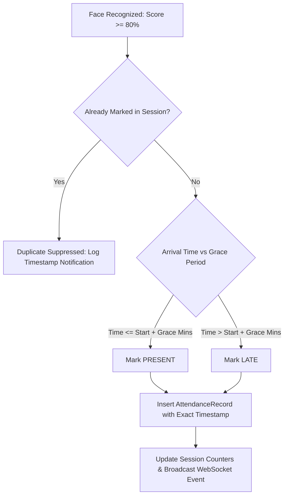

# AttendAI — Attendance Decision Engine & Business Logic

## 1. Core Attendance Rules

AttendAI automates attendance marking while adhering strictly to academic rules:

---

## 2. Status Definitions

| Status | Condition | Action |
|---|---|---|
| `PRESENT` | Face recognized $\ge 80\%$ confidence within grace period ($T \le T_{\text{start}} + \text{Grace}$). | Counter `present_count` incremented. Record created. |
| `LATE` | Face recognized $\ge 80\%$ confidence after grace period ($T > T_{\text{start}} + \text{Grace}$). | Counter `late_count` incremented. Record created. |
| `VERIFY` | Face recognized with ambiguous confidence ($60\% \le \text{Score} < 80\%$). | Event sent to faculty `[VERIFY]` drawer. No status recorded until faculty confirms or rejects. |
| `ABSENT` | Enrolled student not recognized during the active session. | Automatically marked `ABSENT` upon session termination (`PUT /api/sessions/{id}/end`). |

---

## 3. Duplicate Prevention & Suppression

When a student remains in front of the camera or passes by multiple times:
1. The AI engine checks `AttendanceRecord` for `(session_id, student_id)`.
2. If a record already exists, the detection is ignored for attendance counting.
3. A subtle live toast notification confirms: *"Student already marked at 09:14:23 AM"*.
4. Counter values remain accurate and duplicate database records are prevented.

---

## 4. Human-in-the-Loop Verification Workflow

For ambiguous detections ($60\% \le \text{Score} < 80\%$):
1. The event appears with an interactive `[VERIFY]` button on the Live Attendance feed.
2. Clicking `[VERIFY]` slides out the right-hand **Verification Drawer**.
3. The drawer presents:
   - Candidate student name, roll number, and enrolled photo avatar.
   - Recognition confidence score (e.g. `74.2%`).
   - Detection timestamp.
4. Faculty options:
   - **Confirm Attendance**: Upgrades record to `PRESENT` / `LATE` with `is_verified = True` and records `verified_by_faculty_id`.
   - **Reject**: Dismisses the candidate match without marking attendance.
5. All decisions are logged in `audit_logs`.

---

## 5. Manual Override & Audit Trail

Faculty can manually correct any attendance record via `/attendance`:
1. Select student record and click the **Edit (Manual Correction)** icon.
2. Choose new status (`PRESENT`, `LATE`, `ABSENT`).
3. Enter a mandatory **Reason for Correction**.
4. The system logs:
   - User ID of the faculty making the change.
   - Previous status $\to$ New status.
   - Faculty explanation note.
   - Second-level timestamp and IP address.
